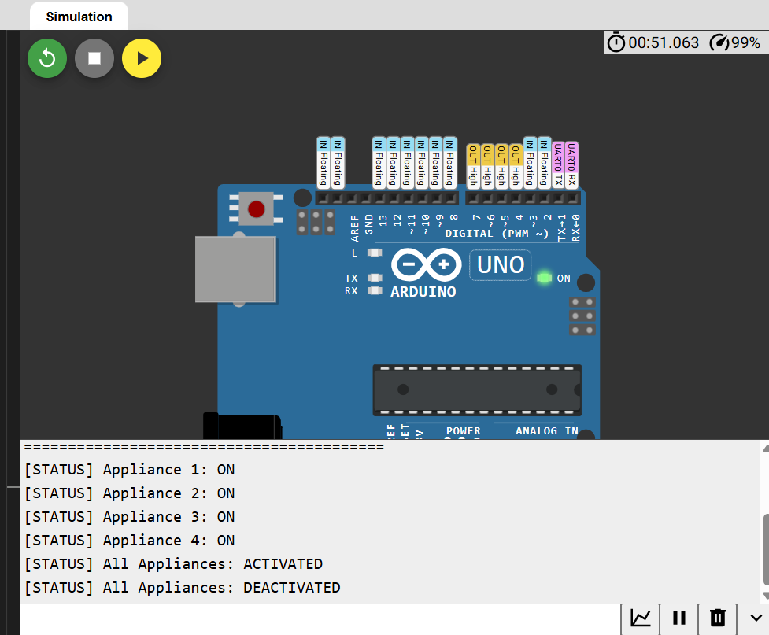

# Home-Automation-via-Bluetooth
* **Intern Name:** Surisetty Epshitha
* **Company:** CODTECH IT SOLUTIONS PVT. LTD.
* **Domain:** Embedded Systems
* **Duration:** 4 Weeks

---

## 📌 Project Overview
This project presents the design and simulation of a smart wireless Home Automation System controlled via serial/Bluetooth command frames. The system acts as a digital controller managing 4 AC/DC electrical appliances via relay logic switches driven by an ATmega328P (Arduino Uno) microcontroller.

---

## 🛠️ Software & Simulation Tools
* **Platform:** Wokwi Virtual Circuit Simulator 
* **Microcontroller:** ATmega328P (Arduino Uno Architecture)
* **Development Language:** Embedded C++ (Arduino Framework)
* **Interface Protocol:** Serial UART (Baud Rate: 9600 bps)

---

## 🔌 Virtual Pin Assignment

| Peripheral Pin | Microcontroller Pin | Function |
|---|---|---|
| Relay Channel 1 | Digital Pin 4 | Controls Appliance 1 |
| Relay Channel 2 | Digital Pin 5 | Controls Appliance 2 |
| Relay Channel 3 | Digital Pin 6 | Controls Appliance 3 |
| Relay Channel 4 | Digital Pin 7 | Controls Appliance 4 |
| UART RX | Digital Pin 0 / Pin 2 | Bluetooth/Serial Data In |
| UART TX | Digital Pin 1 / Pin 3 | Status Telemetry Out |

---

## 🎮 Command Frame Reference

| Received Key | Relay State | System Output |
|---|---|---|
| `'1'` | Relay 1 LOW (Active) | Appliance 1: ON |
| `'a'` / `'A'` | Relay 1 HIGH (Inactive) | Appliance 1: OFF |
| `'2'` | Relay 2 LOW (Active) | Appliance 2: ON |
| `'b'` / `'B'` | Relay 2 HIGH (Inactive) | Appliance 2: OFF |
| `'3'` | Relay 3 LOW (Active) | Appliance 3: ON |
| `'c'` / `'C'` | Relay 3 HIGH (Inactive) | Appliance 3: OFF |
| `'4'` | Relay 4 LOW (Active) | Appliance 4: ON |
| `'d'` / `'D'` | Relay 4 HIGH (Inactive) | Appliance 4: OFF |
| `'9'` | All Relays LOW | All Appliances: ACTIVATED |
| `'0'` | All Relays HIGH | All Appliances: DEACTIVATED |

---

## 📊 Simulation Results
The code was simulated and verified using the Wokwi online simulation platform. All state routines and serial command buffers executed predictably under simulated clock cycles.

